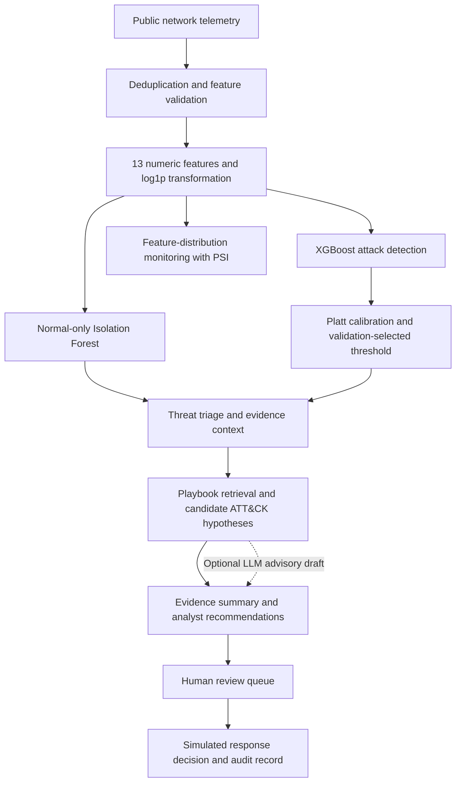

# AI-Powered Cyber Threat Detection & SOC Investigation Assistant

A defensive research prototype combining calibrated machine-learning detection, anomaly scoring, evidence-grounded investigation, and human-reviewed response decisions.

The measured experiment uses **public KDD Cup 1999 network records**, not live banking telemetry. The project demonstrates an investigation workflow; it does not establish production SOC performance or execute containment actions.

## Architecture

| Layer | Implemented approach | Interpretation |
|---|---|---|
| Security telemetry | Public network records with SHA-256 provenance; separate authentication and endpoint normalization adapters | The benchmark contains no real account/device identities or timestamps for cross-source correlation. |
| Feature engineering | 13 numeric connection features; finite/nonnegative validation; `log1p` transformation | Features cover duration, byte volumes, failed logins, connection counts, service diversity, and error rates. |
| Supervised detection | XGBoost binary classifier, 100 trees, maximum depth 4 | Predicts normal versus attack, not attack family or ATT&CK technique. |
| Anomaly detection | Isolation Forest trained only on normal fit-partition records | Provides a separate novelty score, not an attack probability. |
| Calibration and prioritization | Logistic calibration of XGBoost margins; F2-based threshold selection on validation data | High priority at score ≥ 0.9; medium for other threshold-crossing records; low otherwise. |
| Investigation | TF-IDF/cosine retrieval over four curated playbooks; selected event evidence and corroboration recommendations | Default summaries are deterministic retrieval, not generated LLM analysis. An optional LLM path drafts advice from the supplied evidence and playbooks. |
| ATT&CK mapping | Candidate hypotheses linked to T1046, T1110, T1498, and an endpoint-review playbook for T1059 | These are investigation references, not learned or confirmed technique classifications. |
| Human review | SQLite queue with approve/reject decisions, rationale, duplicate-decision protection, and transactional audit records | All response actions are simulations; no account, endpoint, or network changes are executed. |
| Monitoring | Precision–recall and reliability curves, confusion matrix, global feature importance, and population stability index (PSI) | PSI indicates feature-distribution change, not proof of model degradation. |

**Implementation boundaries:** Authentication and endpoint adapters are not scored by the network detector. Optional PySpark five-minute authentication aggregation is implemented separately; the measured training run did not use Spark. Cross-source correlation, modern enterprise validation, and operational response integration remain future work. LLM investigation quality and analyst productivity have not been measured.

## Model results

The results below are from the **committed benchmark evaluation**, recorded in [metrics.json](artifacts/metrics.json), rather than a claim about every retraining run.

| Measure | Held-out result |
|---|---:|
| Precision | **98.07%** |
| Recall | **99.84%** |
| F1 score | **98.95%** |
| Average precision | **0.99976** |
| Brier score | **0.00254** |
| Validation-selected alert threshold | **0.05** |
| Test records | **2,000** |
| Attack prevalence in test set | **30.55%** |

### Confusion matrix

| Actual class | Predicted normal | Predicted attack |
|---|---:|---:|
| Normal | 1,377 | 12 |
| Attack | 1 | 610 |

At the selected threshold, the model detected **610 of 611 attack records**, missed **1**, and flagged **12 normal records**. These counts describe the historical benchmark only, not expected incident volume or false-positive workload in a modern SOC.

### Evaluation design

- Start with the public KDD99 10% dataset; remove conflicting-label vectors and duplicate vectors across the 13 selected predictors before sampling and splitting.
- Use **20,000 records** divided into disjoint stratified partitions: **12,000 fit**, **4,000 calibration**, **2,000 threshold validation**, and **2,000 final test**.
- Fit XGBoost and normal-only Isolation Forest on the fit partition; fit the probability calibrator on the calibration partition.
- Select the alert threshold using F2 on the validation partition, emphasizing recall. The final test partition is not used for model fitting, calibration, or threshold selection.
- Preserve PR/reliability curves and global feature importance in the evaluation artifact. A separate [150-record example set](artifacts/events.json) supports investigation demonstrations; it is not the full evaluation set.

## Investigation and response outputs

Each investigation presents the observed feature evidence, benchmark score, novelty score, candidate hypotheses, retrieved playbook references, missing corroboration, and suggested analyst checks. The [example investigation](artifacts/investigation.json) distinguishes suspicious activity from confirmed compromise.

An analyst may approve or reject a simulated evidence-collection, escalation, host-isolation, or account-restriction playbook. The audit records the decision, stated actor, rationale, and the fact that **nothing was executed**. Analyst names are demonstration attribution, not verified identity, and local audit storage is not an immutable enterprise audit system.

## Interpretation and limitations

- KDD99 is historical simulated traffic with duplication and attack-enriched prevalence. Strong benchmark results do **not** establish modern threat coverage, banking suitability, or generalization to unseen campaigns.
- The split is random and disjoint by selected feature vector, **not temporal validation**. There is no demonstrated cross-source identity/endpoint correlation.
- Calibration is distribution-specific. A score of 0.8 is not a portable 80% probability that a real account or host is compromised.
- ATT&CK hypotheses require independent evidence. Connection counts alone cannot confirm scanning or denial of service.
- Global feature importance is neither a per-alert explanation nor evidence of causality. PSI does not trigger automatic retraining or response.
- The default investigation is deterministic retrieval. Optional LLM output is an untrusted advisory draft requiring analyst verification; there are no executable response tools.

## Dataset attribution

[UCI KDD Cup 1999](https://archive.ics.uci.edu/dataset/130/kdd+cup+1999+data), DOI [10.24432/C51C7N](https://doi.org/10.24432/C51C7N). Attribution: Stolfo, S., Fan, W., Lee, W., Prodromidis, A., & Chan, P. (1999). UCI lists the dataset under CC BY 4.0. Derived examples retain this attribution. The [provenance record](artifacts/provenance.json) identifies the source, checksum, sample size, and preprocessing boundaries.
